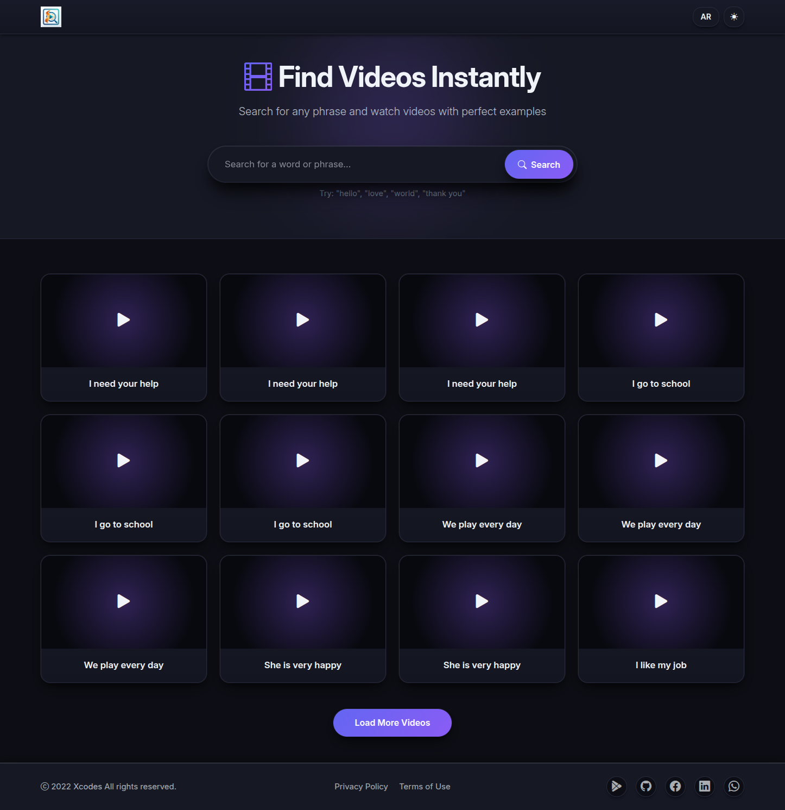
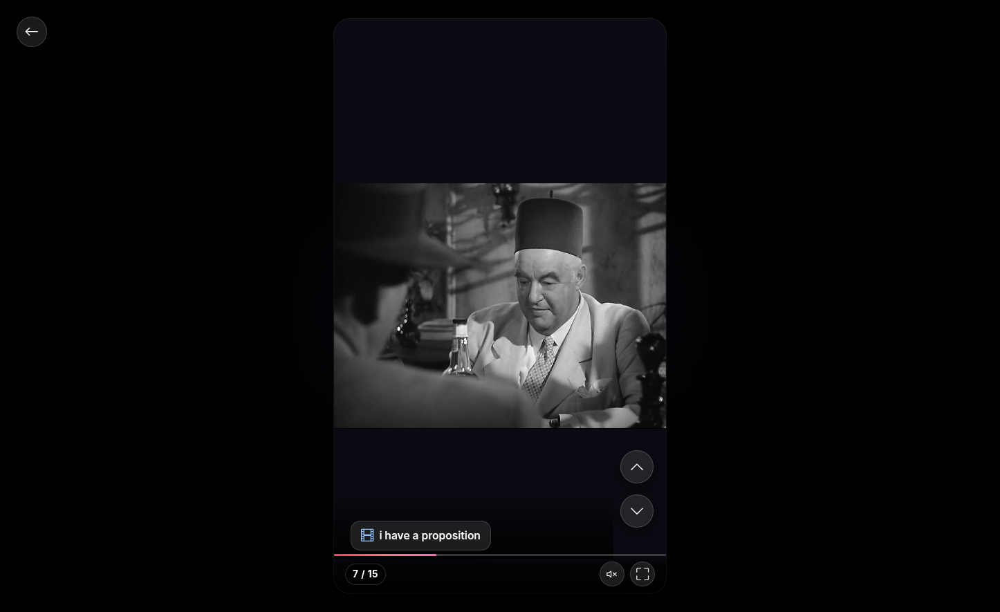

# CinePhrase — Intelligent Video Discovery Platform

**A sophisticated platform engineered for seamless video discovery and intelligent playback experiences.**

CinePhrase is a **high-performance video discovery system** designed to aggregate premium video content, provide intelligent search with instant results caching, and deliver an adaptive video player with comprehensive playback controls. The platform orchestrates complex video organization, intelligent caching mechanisms, and multi-method navigation interaction within a visually stunning responsive interface.

---

## 🎯 Core Platform Capabilities

### 1. Intelligent Video Search System

Delivers a sophisticated search experience optimized for speed and user satisfaction:

- **Instant Feedback**: Search indicators appear immediately for perceived responsiveness without waiting
- **Smart Result Caching**: Repeat queries return cached results instantly from the database
- **Automatic Content Discovery**: New searches trigger server-side video scraping from premium sources
- **Clear Result Handling**: Friendly distinction between "no videos found" (neutral state) and system errors
- **Intelligent Organization**: Results intelligently ranked for maximum user engagement

### 2. Adaptive Video Player

A full-featured playback interface with intelligent organization and comprehensive controls:

- **Smart Video Organization**: Search results displayed first, followed by related videos from the database (no duplicates)
- **Multi-Method Navigation**:
    - Keyboard controls (Arrow Up/Down for sequential browsing)
    - Touch gestures (Swipe Up/Down for navigation)
    - Navigation buttons with automatic state management
    - Single-click play/pause with animated feedback
- **Complete Media Controls**:
    - Volume adjustment with persistent user preferences
    - Progress bar seeking with real-time position tracking
    - Video counter display in "X of Y" format
    - Animated play/pause overlays with smooth transitions
    - Full responsive design for all devices
- **Intelligent Features**:
    - Tab visibility detection (auto-pause when hidden)
    - Keyboard navigation support
    - Touch-optimized gesture recognition
    - Smooth state management and transitions

### 3. Progressive Content Browsing

Seamless infinite-scroll pagination for efficient content discovery:

- **Initial Load**: Curated video collection displayed instantly for immediate engagement
- **Progressive Loading**: "Load More" button appends additional content seamlessly without page reload
- **Smart UI Management**: Loading button hides automatically when all videos are loaded
- **Integrated Search**: Combined search results with full video database browsing

---

## 🏗 Technical Architecture

### System Foundation

| Component    | Technology           | Purpose                                        |
| ------------ | -------------------- | ---------------------------------------------- |
| **Backend**  | Laravel 12 (PHP 8.3) | Synchronous request processing & scraping      |
| **Frontend** | jQuery + Bootstrap 5 | Responsive UI with modular component design    |
| **Database** | MySQL 8.0            | Optimized relational schema for video data     |
| **Pattern**  | Module Pattern       | Encapsulated, reusable components (16 modules) |
| **State**    | Centralized Store    | VideoState - single source of truth            |
| **Scraping** | Symfony Panther      | Chrome automation with stealth detection       |

### Core Design Principles

**Synchronous Execution**: Direct video scraping ensures guaranteed response delivery and simplified error handling  
**Modular Architecture**: 16 focused JavaScript modules with clear separation of concerns  
**Centralized State Management**: VideoState object maintains consistency across application  
**Performance Optimization**: Intelligent caching, DOM element reuse, and optimized database queries

---

## ✨ Platform Features

### Search & Discovery

✅ Instant search feedback without perceived delay  
✅ Automatic result caching for instant retrieval on repeat searches  
✅ Non-blocking responsive interface during search operations  
✅ Comprehensive error handling with user-friendly messaging  
✅ 180-second timeout to complete thorough searches

### Video Playback

✅ Intelligent video sequencing with search results prioritized  
✅ Complete deduplication preventing duplicate entries  
✅ Synchronized navigation across keyboard, touch, and button methods  
✅ Smooth animated transitions and visual feedback  
✅ Tab awareness for bandwidth optimization

### System Quality

✅ 16 modular, maintainable components  
✅ 19 comprehensive test cases for reliability  
✅ Robust error handling for 7 error scenarios  
✅ Production-grade performance and stability

---

## 🌍 Multi-Language Support

Full support for multiple languages with RTL/LTR layout optimization:

- **Arabic**: Native RTL layout with complete UI adaptation
- **English**: Standard LTR layout with optimized typography
- **Seamless Switching**: One-click language toggle without page reload
- **Translated Content**: All UI elements and messages in selected language

---

## 🎨 User Experience Design

### Theme Support

- **Light Mode**: Clean, bright interface for daytime usage
- **Dark Mode**: Eye-friendly interface for low-light environments
- **Persistent Preferences**: User theme preference saved automatically
- **Smooth Transitions**: Theme switching with elegant animations

### Responsive Design

- Optimized for desktop, tablet, and mobile devices
- Touch-friendly controls and gesture support
- Adaptive layouts for all screen sizes
- Full accessibility compliance with keyboard navigation

---

## 📊 Technical Specifications

**Performance**: Sub-100ms search response for cached queries | ~40 seconds for new scrapes  
**Scalability**: Optimized queries supporting thousands of video entries  
**Reliability**: Comprehensive error handling with graceful degradation  
**Accessibility**: Full keyboard navigation and screen reader support  
**Caching**: Smart database caching prevents redundant scraping

---

## 📸 Platform Gallery

### Homepage - Video Discovery & Search Interface

Browse and search video collection with instant feedback and load-more pagination

---

### Video Player - Adaptive Playback with Multi-Method Navigation

Full-featured player with comprehensive controls, video sequencing, and responsive design

